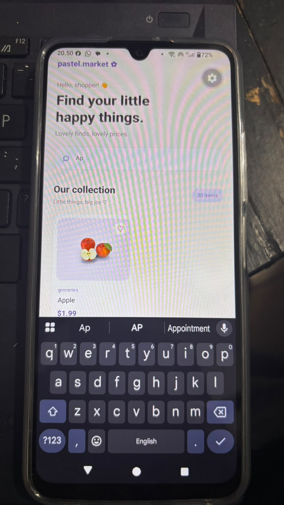

# Katalog Produk DummyJSON

Aplikasi katalog produk sederhana berbasis React Native dan Expo yang menggunakan DummyJSON API untuk menampilkan informasi produk.

## Deskripsi Proyek

Proyek ini dibuat untuk memenuhi tugas individu mata kuliah. Aplikasi memungkinkan pengguna melihat daftar produk, mencari produk berdasarkan nama, dan melihat informasi detail produk.

## Fitur Aplikasi

- Menampilkan daftar produk dari DummyJSON API.
- Menampilkan gambar produk.
- Menampilkan nama dan harga produk.
- Pencarian produk berdasarkan nama.
- Melihat halaman detail produk.
- Tampilan antarmuka dengan warna pastel.

## API yang Digunakan

DummyJSON Products API

Dokumentasi: https://dummyjson.com/docs/products

Endpoint:
`https://dummyjson.com/products`

## Teknologi

- React Native
- Expo
- JavaScript
- DummyJSON API
- Git dan GitHub

## Cara Menjalankan Aplikasi

1. Clone repository:

   ```bash
   git clone https://github.com/syafiqrasyid/katalog-produk-dummyjson..git
   ```

2. Masuk ke folder proyek:

   ```bash
   cd katalog-produk
   ```

3. Install dependencies:

   ```bash
   npm install
   ```

4. Jalankan aplikasi:

   ```bash
   npx expo start
   ```

5. Scan QR Code menggunakan aplikasi Expo Go di Android.

## Screenshot Aplikasi

### Halaman Utama


### Fitur Pencarian



### Halaman Detail Produk


## Video Demonstrasi

Link YouTube: **[Masukkan link video YouTube setelah video diunggah]**

## Repository

https://github.com/syafiqrasyid/katalog-produk-dummyjson.
